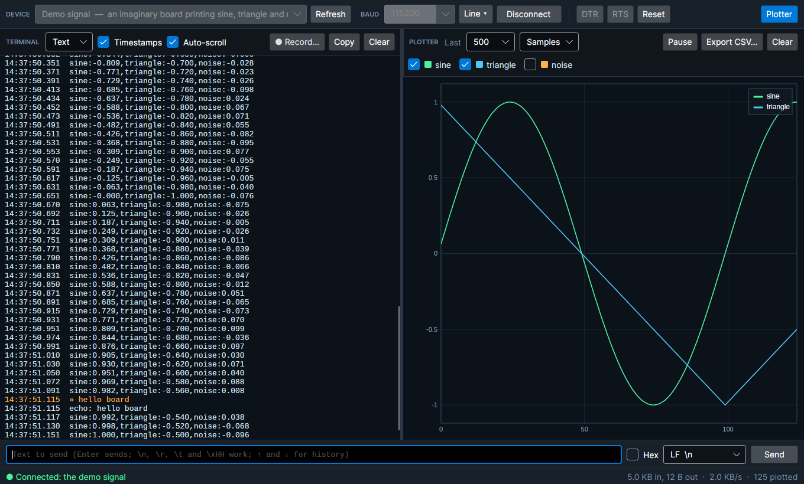
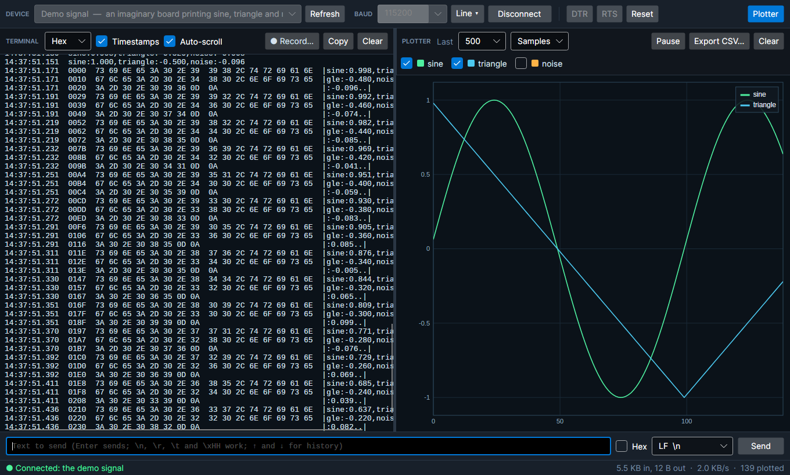

# AVASerMonitor

A serial monitor and live plotter for Windows, macOS and Linux, built with .NET 10 and Avalonia. Point it at an
Arduino, a Pico, an ESP32, a USB-serial adapter or a USB HID device, and watch what it says: as text or as hex in
the terminal, and as live graphs in the plotter, from the same lines the Arduino IDE's Serial Plotter reads.



## What it does

- **Serial ports and USB.** Every serial port the system has: built-in COM ports, USB-serial adapters (FTDI, CH340,
  CP210x, PL2303) and boards that show up as a serial port over USB (Arduino, Raspberry Pi Pico, ESP32, STM32, CDC
  ACM). On Linux each USB one is named by its maker and product, read from the system (`Arduino Uno R3 (2341:0043)`).
  And **USB HID devices**, read directly with no serial port at all: each input report arrives as a row of hex, and
  output reports can be sent back.
- **Any line setup.** Any baud rate (pick from the list or type one), 5 to 8 data bits, any parity, 1, 1.5 or 2 stop
  bits, and RTS/CTS or XON/XOFF flow control. **DTR** and **RTS** can be raised and dropped while connected, and
  **Reset** pulses them, which restarts most Arduino-style boards.
- **A terminal** that shows what arrives line by line (UTF-8, ASCII or Latin-1, with control characters shown as
  their symbols: ␀, ␛) or as **hex**, sixteen bytes to a row with the printable characters beside them. Timestamps
  to the millisecond, auto-scroll, copy, and lines held back until they end (a prompt with no newline still shows).
- **A plotter** that draws the numbers in what arrives as live lines, the same way the Arduino Serial Plotter reads
  them, so a sketch written for that plots here unchanged. Show the last 100 to 5,000 samples or all of them, against
  the sample number or the time, switch each series on and off, pause to look, and hover for each series' value.
- **Sending** text (with no line ending, LF, CR or CR LF, and escapes such as `\r`, `\n`, `\t` and `\x1B`) or hex
  bytes, with the last fifty lines sent a keypress away (↑ and ↓).
- **Recording** to a file: a text log with each line's time and what was sent marked `>>`, or the raw bytes (`.bin`)
  exactly as they came. **Export CSV** saves every plotted value, a column per series.
- **A demo signal**, an imaginary board printing a sine, a triangle and some noise fifty times a second, so all of
  it can be tried with nothing plugged in.
- Settings, the last device and the send history are remembered. Devices plugged in or out show up by themselves.

## What it plots

A line is plot data when everything on it is a number or a named number. Anything else (a word, a unit, a
sentence) stays text and isn't plotted.

| The device prints | The plotter draws |
| --- | --- |
| `12.5, 30, -4` (commas, spaces, tabs or semicolons) | three series, named 1, 2 and 3 |
| `temp:21.5 humidity:40` or `temp=21.5,humidity=40` | a series for each name |
| `voltage,current` then `5,0.2` | a header line names the plain columns after it |
| `Temperature is 23.5 C` | nothing: it's text |

In an Arduino sketch that is

```cpp
Serial.print("temp:");     Serial.print(t);
Serial.print(",humidity:"); Serial.println(h);
```



## Download

Builds for Windows (x64, x86, ARM64), macOS (Intel and Apple Silicon) and Linux (x64, ARM64 and 32-bit ARM, such as
a Raspberry Pi) are on the [releases page](../../releases): `latest` is the newest build of `main`. Unzip or untar
it and run `AVASerMonitor` (`AVASerMonitor.exe` on Windows). Each is a single self-contained file; nothing else needs
installing.

### Permissions on Linux

- **Serial ports** belong to a group you need to be in: `dialout` on Debian, Ubuntu and Raspberry Pi OS, `uucp` on
  Arch. `sudo usermod -aG dialout $USER`, then log out and in again.
- **USB HID devices** are read through their `/dev/hidraw*` node, which ordinary users can't open by default. A udev
  rule gives you one device (the app's error message gives the exact line with your device's IDs), for example in
  `/etc/udev/rules.d/70-avasermonitor.rules`:

  ```
  KERNEL=="hidraw*", ATTRS{idVendor}=="2341", ATTRS{idProduct}=="8036", MODE="0660", TAG+="uaccess"
  ```

  then `sudo udevadm control --reload && sudo udevadm trigger`. Keyboards and mice are usually held by the system
  and can't be read this way on any platform.

On macOS each port appears as `/dev/cu.*`, the one to use (its `/dev/tty.*` twin waits for a carrier signal).

## Keys

| | |
| --- | --- |
| `Enter` | Send what is in the send box |
| `↑` / `↓` | Step through what was sent before |
| `F5` | Connect or disconnect |
| `Ctrl` `L` | Clear the terminal |

## Building

```bash
dotnet build AVASerMonitor.slnx
dotnet test AVASerMonitor.slnx
dotnet run --project src/AVASerMonitor
```

.NET 10 (see `global.json`). `src/AVASerMonitor.Core` has everything but the window: the connections (serial,
USB HID and the demo), finding devices, turning bytes into lines, hex and plot values, and recording, so it is
tested without a window. `src/AVASerMonitor` is the Avalonia app. The tests include a real serial port with no
hardware: on Linux and macOS a pseudo-terminal pair stands in for the cable. CI builds and tests every push and
publishes all eight builds.

## License

MIT. See [LICENSE](LICENSE).
